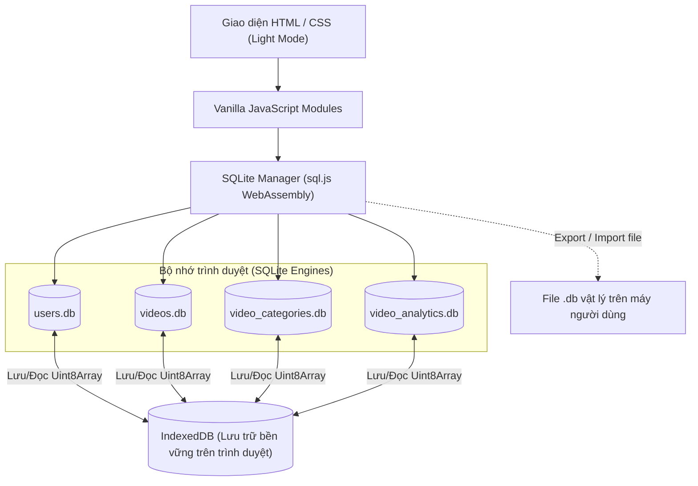

# Kiến trúc Hệ thống (System Architecture)

Tài liệu này mô tả cách xây dựng ứng dụng Web Admin quản lý video chỉ sử dụng **HTML, CSS, JavaScript** và **SQLite** mà **không cần Backend Server**.

---

## 1. Giải pháp kỹ thuật: SQLite không cần Backend

Trình duyệt web thông thường không thể đọc/ghi trực tiếp file hệ thống do cơ chế bảo mật Sandbox. Để sử dụng nhiều cơ sở dữ liệu SQLite (`users.db`, `videos.db`, `video_categories.db`, `video_analytics.db`) thuần Frontend, hệ thống sử dụng kiến trúc **WebAssembly SQLite (`sql.js`) kết hợp với `IndexedDB`**:

### Cơ chế hoạt động:
1. **Khởi tạo (`initDatabase`)**:
   - Khi mở trang web, `sql.js` nạp file thực thi WebAssembly (`sql-wasm.wasm`).
   - Hệ thống kiểm tra trong `IndexedDB` xem đã có dữ liệu nhị phân (`Uint8Array`) của 4 file `users.db`, `videos.db`, `video_categories.db`, `video_analytics.db` hay chưa.
   - Nếu **đã có**: Khôi phục các instance `new SQL.Database(uint8Array)` từ `IndexedDB`.
   - Nếu **chưa có**: Khởi tạo database mới, chạy script `CREATE TABLE` và `INSERT` dữ liệu mẫu (Seed Data), sau đó lưu ngay vào `IndexedDB`.
2. **Ghi dữ liệu (`saveDatabase`)**:
   - Mỗi khi thực hiện lệnh `INSERT`, `UPDATE`, `DELETE`, hệ thống gọi `db.export()` để xuất ra mảng byte chuẩn định dạng SQLite `.db` và cập nhật vào `IndexedDB`.
3. **Liên kết dữ liệu giữa các file `.db` khác nhau**:
   - Sử dụng tính năng **`ATTACH DATABASE`** của SQLite thông qua hệ thống file ảo (`FS.writeFile`) của `sql.js`, hoặc thực hiện kết nối dữ liệu (Join/Map) ở tầng Repository JavaScript giữa `videos.db` và `video_categories.db`.
4. **Xuất / Nhập file `.db` thật**:
   - Người dùng có thể bấm nút **"Tải xuống Database"** để tải trực tiếp các file `users.db`, `videos.db`, `video_categories.db`, `video_analytics.db` về máy và mở bằng phần mềm *DB Browser for SQLite*.

---

## 2. Phân tách các Cơ sở dữ liệu (Multi-Database Architecture)

Theo yêu cầu đề bài, hệ thống tách biệt rõ ràng trách nhiệm của từng database:

| Tên Database | Trách nhiệm chính | Các bảng bên trong |
| :--- | :--- | :--- |
| **`users.db`** | Quản lý tài khoản admin, xác thực đăng nhập, đăng ký, đặt lại mật khẩu. | `users`, `password_resets` |
| **`videos.db`** | Quản lý kho video, lượt xem tổng, dung lượng file (MB), hình thu nhỏ. | `videos` |
| **`video_categories.db`** | Quản lý danh mục phân loại video và thẻ gắn kèm. | `categories`, `tags` |
| **`video_analytics.db`** | Lưu lịch sử lượt xem theo từng ngày và từng tháng để phục vụ biểu đồ Line Chart. | `daily_views`, `monthly_views` |

---

## 3. Tích hợp Supabase Cloud (`supabase-client.js`)

Ngoài 4 cơ sở dữ liệu SQLite cục bộ, hệ thống được kết nối trực tiếp tới **Supabase Cloud** theo cấu hình trong [supabase.txt](file:///d:/0.hanh/Bai4_1/supabase.txt):
- **Project URL**: `https://qhkdldltwqnwpmifqdcj.supabase.co`
- **Publishable Key**: `sb_publishable_th6ALyrrhz5qWwppeBOlRw_ouLOX2CU`
- **Tệp khởi tạo bảng**: [supabase_setup.sql](file:///d:/0.hanh/Bai4_1/supabase_setup.sql)
- **Tầng kết nối**: [supabase-client.js](file:///d:/0.hanh/Bai4_1/assets/js/db/supabase-client.js) tự động đồng bộ 2 chiều giữa các bảng trên Supabase (`users`, `categories`, `videos`, `daily_views`, `monthly_views`) và 4 cơ sở dữ liệu SQLite trên trình duyệt.

---

## 4. Luồng hoạt động của các trang (Page Flows)

### 3.1. Luồng Xác thực (`auth-guard.js`)
- Mọi trang quản trị (`index.html`, `videos.html`) đều nhúng `auth-guard.js` ở đầu trang.
- Kiểm tra `localStorage.getItem('current_admin_user')`.
- Nếu chưa đăng nhập -> Tự động chuyển hướng (`window.location.href = 'login.html'`).
- Nếu đã đăng nhập -> Hiển thị tên và ảnh đại diện của Admin trên góc phải Header.

### 3.2. Luồng Trang Dashboard (`dashboard.js`)
1. Mở kết nối tới `videos.db`, `video_categories.db`, và `video_analytics.db`.
2. Thực thi 3 truy vấn SQL lấy tổng số video, tổng lượt xem, và tổng dung lượng lưu trữ -> Render lên 3 thẻ KPI.
3. Thực thi truy vấn lấy Top 10 video có `views` lớn nhất từ `videos.db` -> Truyền dữ liệu vào **Chart.js Bar Chart**.
4. Thực thi truy vấn lấy chuỗi thời gian lượt xem theo ngày/tháng từ `video_analytics.db` -> Truyền dữ liệu vào **Chart.js Line Chart**.

### 3.3. Luồng Trang Quản lý Video (`videos.js`)
1. Lấy danh sách toàn bộ danh mục từ `video_categories.db` để tạo Map `{ category_id: category_name }` và đổ vào Dropdown lọc.
2. Lấy danh sách video từ `videos.db` (`SELECT id, title, thumbnail, views, file_size_mb, duration, category_id FROM videos ORDER BY id DESC`).
3. Render từng dòng vào bảng HTML với nút **Edit** và **Delete**.
4. Khi bấm **Edit**: Mở Modal, điền sẵn dữ liệu của video đó. Khi lưu, chạy lệnh `UPDATE videos SET ... WHERE id = ?`, đồng thời cập nhật lại `IndexedDB` và vẽ lại bảng.
5. Khi bấm **Delete**: Xác nhận và chạy lệnh `DELETE FROM videos WHERE id = ?`, cập nhật `IndexedDB` và vẽ lại bảng.
